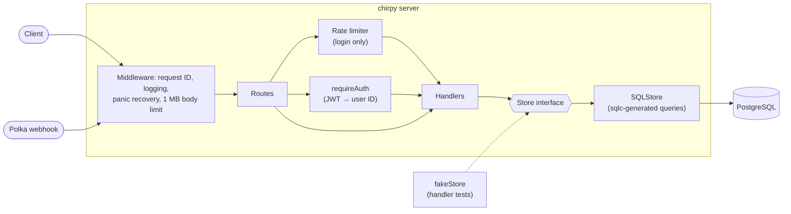

# Chirpy

[](https://github.com/danielakinremi1-dev/chirpy-social-api/actions/workflows/ci.yml)
[](https://codecov.io/gh/danielakinremi1-dev/chirpy-social-api)
[](go.mod)

A microblogging REST API in Go and PostgreSQL, with JWT auth, rotating refresh tokens, cursor pagination, and tests against a real database.

**Live:** <https://chirpy-8n8c.onrender.com> · [Interactive API docs](https://chirpy-8n8c.onrender.com/docs)

> It runs on Render's free tier, which sleeps after 15 minutes without traffic, so the first request after a quiet spell can take up to a minute while it wakes. Requests after that are fast.

## Quickstart

With Docker installed:

```sh
git clone https://github.com/danielakinremi1-dev/chirpy-social-api.git
cd chirpy-social-api
docker compose up --build
```

That starts Postgres, applies the migrations, and serves the API on port 8080. Open <http://localhost:8080/docs> for interactive API docs.

## Features

- **Accounts and auth:** argon2id password hashing, one-hour JWT access tokens, and single-use refresh tokens that rotate on every refresh.
- **Chirps:** 140-character posts with a word filter, author filtering, and cursor pagination.
- **Webhooks:** a payment-provider webhook authenticated by API key, compared in constant time.
- **Operations:** JSON logs with a request ID on every line, per-IP login rate limiting, request size limits, timeouts, panic recovery, and graceful shutdown.
- **Docs:** an OpenAPI 3 spec served with Swagger UI at `/docs`, checked against the real routes in a test.

## Architecture



Handlers depend on a small `Store` interface: sqlc's generated `Querier` plus an `InTx` method for transactions. Production uses Postgres; handler tests use an in-memory fake, and integration tests use a real Postgres in a container.

```
cmd/chirpy/          startup: config, database, HTTP server, graceful shutdown
internal/api/        handlers, routes, middleware, response helpers
internal/auth/       password hashing, JWTs, refresh tokens, header parsing
internal/config/     environment variables → Config
internal/database/   sqlc-generated query code
sql/schema/          goose migrations (embedded in the binary)
sql/queries/         SQL that sqlc compiles into Go
api/openapi.yaml     OpenAPI 3 spec
web/                 static landing page served at /app/
```

## Design decisions

**argon2id for passwords.** Argon2 won the Password Hashing Competition, and its argon2id variant is OWASP's first recommendation for password storage. Unlike bcrypt, it is memory-hard, which makes GPU and ASIC cracking much more expensive, and it has no 72-byte input limit. Login also hashes a dummy password when the email doesn't exist, so response time doesn't reveal which emails are registered.

**Refresh-token rotation.** Every call to `/api/refresh` revokes the token presented and issues a new one, inside a single transaction. The revoke is a conditional `UPDATE ... WHERE revoked_at IS NULL`, so if two requests race with the same token, Postgres's row lock lets exactly one of them win; an integration test fires 8 concurrent refreshes and checks that one succeeds. A stolen refresh token is therefore usable at most once, and the legitimate client notices when its own refresh fails.

**sqlc instead of an ORM.** Queries are plain SQL in `sql/queries`, checked against the schema at generation time and compiled into typed Go functions. There's no runtime reflection or query builder to learn, the SQL that runs is exactly the SQL in the repo, and CI fails if the generated code drifts from the queries (`sqlc diff`).

**Cursor pagination instead of offsets.** `GET /api/chirps` pages with a cursor encoding the last row's `(created_at, id)`, and the query uses a row comparison (`(created_at, id) > ($1, $2)`) backed by a matching index. Unlike `OFFSET`, the cost doesn't grow with page depth, and inserts between requests don't make pages skip or repeat rows. The `id` tiebreaker keeps ordering stable when timestamps collide. The response body stays a plain JSON array, and the next cursor goes in the `X-Next-Cursor` header.

**Timestamps as `TIMESTAMPTZ`.** All timestamps are stored as absolute instants, so the API reports the same time regardless of the database server's time zone.

## API

Full request and response schemas are in [api/openapi.yaml](api/openapi.yaml), or at `/docs` on a running server. Access tokens go in `Authorization: Bearer <token>`; the webhook uses `Authorization: ApiKey <key>`.

| Method and path | Description |
| --- | --- |
| `POST /api/users` | Create an account. Body: `{"email", "password"}`; passwords need at least 8 characters. Returns 409 if the email is taken. |
| `PUT /api/users` | Update your email and password. Requires an access token. |
| `POST /api/login` | Log in. Returns the user, a one-hour access token, and a 60-day refresh token. Limited to 10 attempts per IP, refilled at one every 6 seconds. |
| `POST /api/refresh` | Exchange a refresh token (Bearer) for a new access token and a new refresh token. The old refresh token stops working. |
| `POST /api/revoke` | Revoke a refresh token (Bearer). |
| `POST /api/chirps` | Post a chirp: `{"body": "..."}`, up to 140 characters. Requires an access token. |
| `GET /api/chirps` | List chirps, 20 per page. Query: `author_id`, `sort=asc\|desc`, `limit` (max 100), `cursor`. The next page's cursor is in the `X-Next-Cursor` header. |
| `GET /api/chirps/{chirpID}` | Get one chirp. |
| `DELETE /api/chirps/{chirpID}` | Delete one of your chirps. Requires an access token. |
| `POST /api/polka/webhooks` | Handle a payment event; `user.upgraded` grants Chirpy Red. Requires the Polka API key. |
| `GET /api/healthz` | Readiness check. |
| `GET /admin/metrics` | Visit count for the `/app/` page. |
| `POST /admin/reset` | Delete all users and their data. Only when `PLATFORM=dev`. |
| `GET /docs` | Swagger UI. |
| `GET /` | Redirects to the landing page at `/app/`. |

### Examples

These use [jq](https://jqlang.org) to pull values out of responses.

```sh
API=http://localhost:8080   # or https://chirpy-8n8c.onrender.com

# Create an account and log in.
curl -s -X POST $API/api/users -d '{"email":"ada@example.com","password":"correct-horse"}'
LOGIN=$(curl -s -X POST $API/api/login -d '{"email":"ada@example.com","password":"correct-horse"}')
TOKEN=$(echo "$LOGIN" | jq -r .token)
REFRESH=$(echo "$LOGIN" | jq -r .refresh_token)

# Post a chirp.
curl -s -X POST $API/api/chirps -H "Authorization: Bearer $TOKEN" -d '{"body":"Hello, Chirpy!"}'

# List the newest chirps, two per page, and fetch the next page.
CURSOR=$(curl -s -D - -o /dev/null "$API/api/chirps?sort=desc&limit=2" | grep -i x-next-cursor | cut -d' ' -f2 | tr -d '\r')
curl -s "$API/api/chirps?sort=desc&limit=2&cursor=$CURSOR"

# Rotate tokens. The old refresh token is now revoked.
curl -s -X POST $API/api/refresh -H "Authorization: Bearer $REFRESH"
```

## Development

Requirements: Go 1.27+, PostgreSQL, and Docker for the integration tests. The [goose](https://github.com/pressly/goose) and [sqlc](https://sqlc.dev) CLIs are only needed for `make migrate-*` and `make sqlc`.

```sh
cp .env.example .env     # then set DB_URL, SECRET, and POLKA_KEY
make migrate-up          # or set MIGRATE_ON_START=true in .env
make run
```

| Command | What it does |
| --- | --- |
| `make test` | Unit and handler tests with the race detector. |
| `make test-integration` | Also runs the Postgres integration tests (needs Docker). |
| `make cover` | Coverage across `internal/`, including integration tests. |
| `make lint` | gofmt check, `go vet`, and golangci-lint. |
| `make migrate-up` / `migrate-down` / `migrate-status` | Run goose against `DB_URL`. |
| `make sqlc` | Regenerate `internal/database` from `sql/queries`. |
| `make docker-up` / `docker-down` | Start or stop the Compose stack. |

CI runs formatting, vet, golangci-lint, the full test suite with the race detector and integration tests, a coverage check (fails below 70%, with the report uploaded to Codecov), and `sqlc diff` on every push and pull request.

### Configuration

| Variable | Required | Description |
| --- | --- | --- |
| `DB_URL` | Yes | Postgres connection string. |
| `SECRET` | Yes | JWT signing key. Generate one with `openssl rand -base64 64`. |
| `POLKA_KEY` | Yes | API key the Polka webhook must send. |
| `PLATFORM` | No | `dev` enables `POST /admin/reset`. The server refuses to start with `dev` on Render. |
| `PORT` | No | Listen port. Default `8080`. |
| `MIGRATE_ON_START` | No | `true` applies pending migrations at startup. |
| `TRUST_PROXY` | No | `true` takes the client IP (for rate limiting and logs) from the last `X-Forwarded-For` entry, which the reverse proxy appends. Only enable it behind such a proxy. |

## Deployment

The [live API](https://chirpy-8n8c.onrender.com) runs on Render's free tier, defined in [render.yaml](render.yaml), with the database on Neon's free Postgres.

- Render builds the Dockerfile and redeploys after CI passes on `main`.
- Render generates `SECRET`; `DB_URL` and `POLKA_KEY` are set in its dashboard. `PLATFORM=production` and `TRUST_PROXY=true` come from `render.yaml`, and the server refuses to start with `PLATFORM=dev` on Render.
- Migrations are applied by hand with Neon's direct (non-pooled) connection string:

  ```sh
  goose -dir sql/schema postgres "$NEON_DB_URL" up
  ```
- The app's Postgres driver (lib/pq) doesn't support the `channel_binding` parameter in Neon's default connection string, so the app's `DB_URL` drops it and uses `sslmode=verify-full`, which checks Neon's certificate against the system CA store.

## What I'd do next

- **Refresh-token reuse detection:** if a revoked refresh token is presented, revoke every token descended from the same login, since reuse means a token was stolen.
- **Idempotent webhooks:** store each event ID and ignore replays.
- **Shared rate limiting:** keep the login counters in Redis so limits hold across several instances, not just one process.
- **Metrics:** a Prometheus `/metrics` endpoint with request counts and latency histograms, replacing the HTML hit counter.
- **Follows and a feed:** a `follows` table and a `GET /api/feed` timeline, to show join and index design under a heavier read path.
